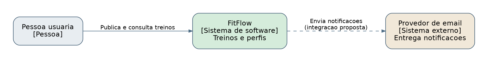
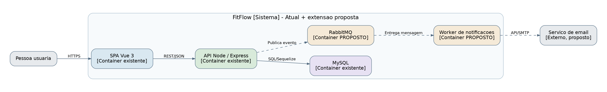
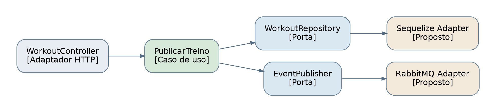

# Modelo C4 - Extensao de Mensageria (PROPOSTA)

## C1 - Contexto de software

## C2 - Containers

**Existentes na N9:** SPA Vue 3, API Node.js/Express, MySQL.
**Propostos:** RabbitMQ, worker de notificacoes, provedor externo.

## C3 - Componentes da API (recorte da publicacao)

No recorte C3, `WorkoutController` representa a entrada ja observada na N9. `PublicarTreino`, `WorkoutRepository`, `EventPublisher` e adaptadores separados ilustram a reorganizacao proposta, nao componentes ja implementados.

## Fluxo
1. Frontend chama `POST /api/workouts` com credenciais e imagem.
2. API valida e executa caso de uso de publicacao.
3. Treino e persistido em transacao com registro outbox (proposto).
4. Publicador entrega `workout.published.v1` a exchange RabbitMQ.
5. Worker consome mensagem, confirma ACK apos sucesso e notifica via servico externo.
6. Em falha, retentativa ou DLQ; consumidor usa `eventId` para idempotencia.

**Nao incluido na entrega N9:** implementacao de broker, worker e outbox. Documentacao representa uma decisao de arquitetura.
