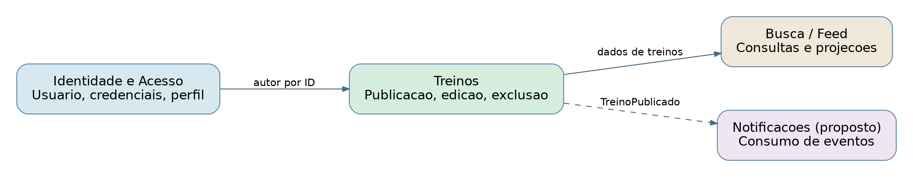
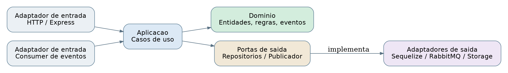

# Arquitetura DDD e Hexagonal - FitFlow N9

## Fonte observada
Backend Node.js/Express + Sequelize/MySQL: `backend/modules/user`, `workout`, `search`; Vue 3 no frontend.
Esta e uma **proposta de reorganizacao**, nao uma refatoracao executada.

## Bounded contexts
- **Identidade e Acesso:** Usuario, cadastro, login, perfil, status de bloqueio.
- **Treinos:** Treino (agregado), publicacao/edicao/exclusao, vinculo a autor por `userId`.
- **Feed e Busca:** modelo de leitura; a busca global atual retorna listas vazias, portanto a projecao e apenas proposta.
- **Notificacoes (proposto):** consumo de `TreinoPublicado` e envio de mensagens por adaptador externo.

## Hexagonal
**Entradas:** controllers Express (HTTP), consumers de eventos (futuro). **Aplicacao:** casos de uso `PublicarTreino`, `EditarTreino`, `ExcluirTreino`, `AtualizarPerfil`, `Entrar`. **Dominio:** entidades e regras sem imports de Express/Sequelize/fs. **Portas de saida:** `WorkoutRepository`, `UserRepository`, `FileStorage`, `PasswordHasher`, `TokenIssuer`, `EventPublisher`. **Adaptadores:** Sequelize/MySQL, disco ou object storage, bcrypt/JWT, RabbitMQ.

## Regras e invariantes sugeridas
- Um treino tem titulo e descricao validos e pertence a um usuario.
- Apenas o autor pode editar ou excluir seu treino.
- Publicar um treino atualiza o contador de treinos de forma consistente.
- O caso de uso nao depende da implementacao de persistencia nem da fila.
- Exclusao de imagens deve ser coordenada sem comprometer a persistencia principal.

## Direcao das dependencias
Adaptadores dependem das portas, e casos de uso dependem de abstracoes. Dominio nao importa Sequelize, Multer, Express, `fs`, JWT ou RabbitMQ.

## Mapa

